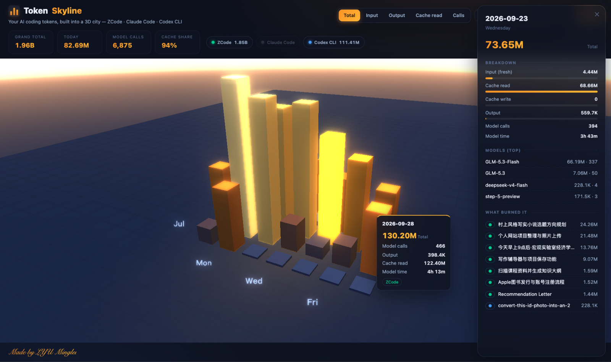

# Token Skyline

<p align="center">
  
</p>

> **Your AI coding tokens, built into a 3D city.**
> 把你的 AI 编程 token 消耗,盖成一座 3D 城市。

Every day you chat with your AI coding agent, it burns tokens. Token Skyline turns
those token bills into a GitHub-style contribution calendar **in 3D** — one bar per
day, taller = more tokens. Hover for the receipt, click a building to see which
projects burned it, switch metrics to watch the whole city reshape, and export the
skyline as an **STL** to 3D-print a real desk ornament.

Inspired by the WeChat article
《[Token消耗在这一刻具像化了](https://mp.weixin.qq.com/s/gmt6TjG355RrBOSjdQYd6w)》(which
was inspired by GitHub's 3D contribution skyline).

[中文说明](README.zh-CN.md)

---

## Features

- **3D calendar city** — weeks × weekdays, one bar per day, orbit / zoom / auto-rotate, bars grow in with an ease
- **Two moods** — 🌙 glowing night city (indigo sky, bloom, stars) & ☀️ warm golden-hour dawn; one click apart
- **5 metrics** — Total · Input · Output · Cache read · Calls; the city reshapes live
- **Hover = receipt** — per-day token breakdown, model calls, model time
- **Click = diary** — which models and which projects/sessions burned the tokens that day
- **Multi-tool, one city** — aggregates ZCode + Claude Code + Codex CLI, color-coded chips, click a chip to filter
- **STL export** — with real-world scale presets (1M tokens = 1 mm …) and base plate, ready for slicers
- **Live** — re-reads local logs every 30 s; today's bar grows while you chat
- **中/EN UI**, compact number formats (亿/万 vs M/K)

## Supported tools

| Tool | Reads (read-only) | Auto-detected |
|---|---|---|
| [ZCode](https://zcode.ai) | `~/.zcode/cli/db/db.sqlite` | ✅ |
| [Claude Code](https://claude.com/claude-code) | `~/.claude/projects/**/*.jsonl` | ✅ |
| [Codex CLI](https://github.com/openai/codex) | `~/.codex/sessions/**/*.jsonl` | ✅ |

Missing your tool? PRs welcome — a scanner is ~40 lines of Python (see below).

## Quick start

```bash
git clone https://github.com/1217776385l-ctrl/token-skyline.git
cd token-skyline
python3 server.py
```

That's it. **Python 3.8+, zero dependencies** (standard library only). Your browser
opens at `http://127.0.0.1:8643`.

Windows: `py server.py`

| Night 🌙 | Dawn ☀️ |
|---|---|
|  |  |

<p align="center">
  
</p>

## 3D printing

Press **STL ⭳**, pick a scale (default **1M tokens = 1 mm** — a 200M-token peak day
prints 20 cm tall), optionally add a 3 mm base plate, download, slice, print.
The export is Z-up, bed-aligned, right-handed — no mirrored prints.

## Privacy

Everything runs locally. The server binds `127.0.0.1`, opens your agent logs
**read-only** (SQLite `mode=ro`), and nothing ever leaves your machine. No telemetry,
no CDN, works offline.

## CLI options

```
--port N          default 8643 (or TOKEN_SKYLINE_PORT)
--host ADDR       default 127.0.0.1
--no-open         don't auto-open the browser
--zcode-db PATH   custom ZCode db.sqlite
--claude-dir PATH custom ~/.claude/projects
--codex-dir PATH  custom ~/.codex/sessions
```

## Tests

```bash
python3 tests/test_parsers.py          # parser unit tests (synthetic fixtures)
python3 tests/make_fixtures.py DIR     # write sample Claude/Codex logs to DIR
```

## Add your own tool

A scanner is a function `scan(root_or_path) -> {date: day}`, where each `day`
accumulates `requests, fresh_in, cache_read, cache_write, out, dur_ms` plus optional
`models` and `contexts` maps. Add it to `SCANNERS` in `server.py` and register its
default path in `default_paths()`. ~40 lines, PRs welcome.

## FAQ

**Numbers look huge — is cache counted?**
Yes. Most coding-agent traffic is cache reads (~95% on this machine, hence a city
built from prefabs). Switch to the *Input* metric to see only fresh tokens, or
*Output* to see what the model actually wrote.

**Multiple machines?**
Point the flags at a synced copy of the log directories, or run one instance per
machine — the data source is just files.

## Credit & license

Inspired by the WeChat article 《Token消耗在这一刻具像化了》 (打杂碎碎念).
Three.js r147 (MIT) is vendored in `lib/`.

MIT © 2026 **LYU Minglei**

<p align="center"><i>Made by LYU Minglei</i></p>
