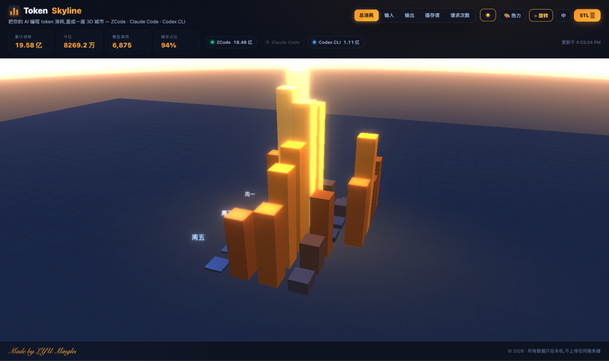
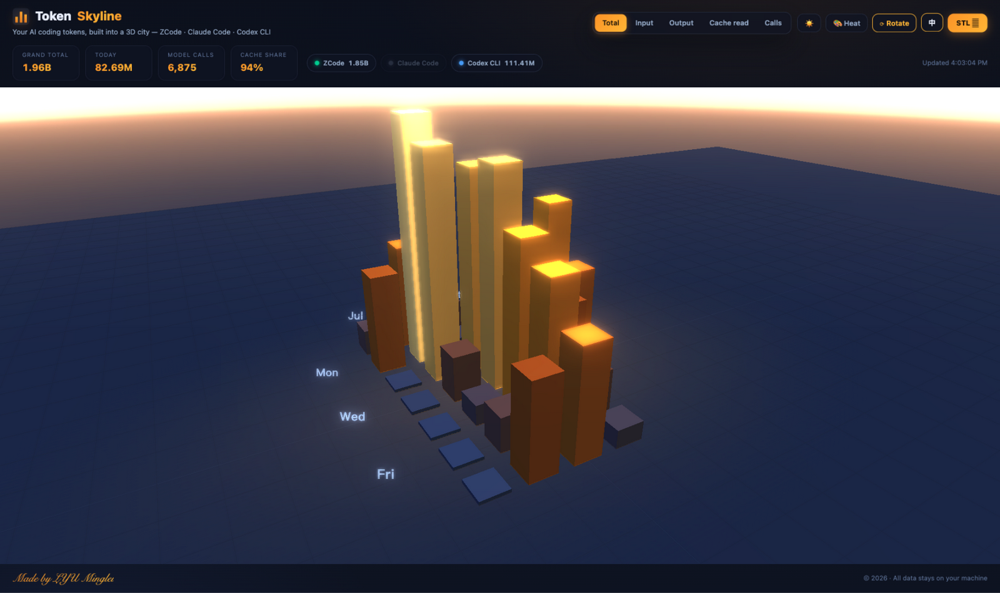
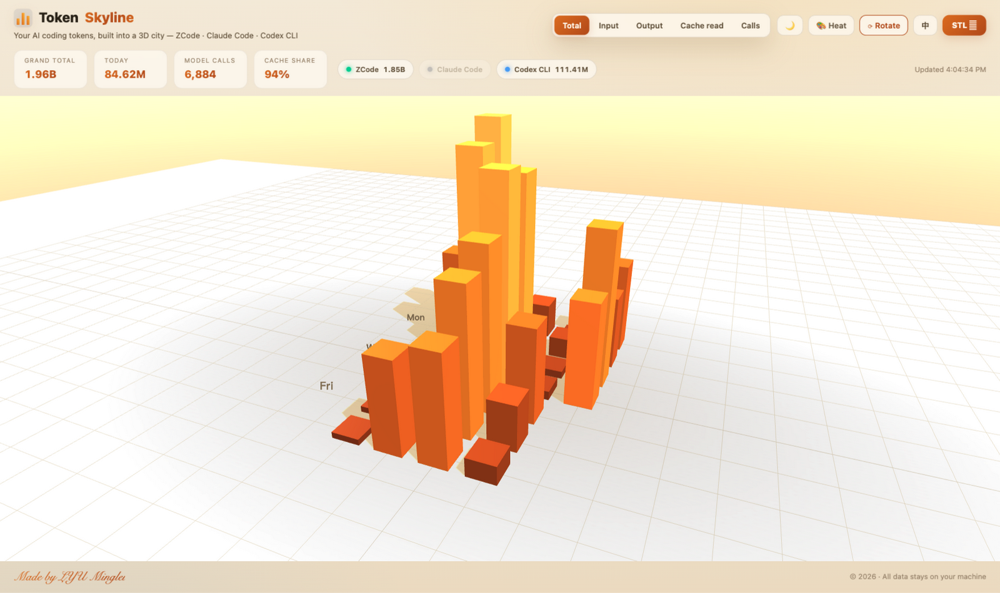

# Token Skyline(中文说明)

<p align="center">
  
</p>

> **把你的 AI 编程 token 消耗,盖成一座 3D 城市。**

你每天和 AI 编程工具对话,它都在烧 token。Token Skyline 把这些账单变成一座
GitHub 提交日历式的 **3D 城市**——一天一根柱子,烧得越多楼越高。悬停看账单,
点击看当天是哪些项目在烧钱,切换指标看城市当场变形,还能一键导出 **STL**
拿去 3D 打印,把天际线摆上书桌。

灵感来自公众号文章
《[Token消耗在这一刻具像化了](https://mp.weixin.qq.com/s/gmt6TjG355RrBOSjdQYd6w)》
(而它又致敬了 GitHub 的 3D 提交天际线)。

[English README](README.md)

---

## 功能

- **3D 日历城市**:周 × 星期网格,一天一柱,可旋转/缩放/自动旋转,柱子带生长动画
- **双主题**:🌙 夜城(靛蓝天空+Bloom 辉光+星点)/ ☀️ 黎明(暖阳沙色+柔影),一键切换
- **五种指标**:总消耗 · 输入 · 输出 · 缓存读 · 请求次数,切换时城市实时变形
- **悬停出账单**:当日 token 构成、模型调用次数、模型耗时
- **点击看日记**:当天是哪个模型、哪些项目/会话在烧钱
- **多工具合一**:自动聚合 ZCode + Claude Code + Codex CLI,按工具配色,点 chip 可过滤
- **STL 导出**:真实比例尺预设(默认 1M token = 1mm)+ 可选底板,切片即打
- **活数据**:每 30 秒重读本地日志,你聊着天,今天的柱子就在长高
- **中/EN 双语界面**,数字本地化(亿/万)

## 支持的工具

| 工具 | 读取(只读) | 自动探测 |
|---|---|---|
| ZCode | `~/.zcode/cli/db/db.sqlite` | ✅ |
| Claude Code | `~/.claude/projects/**/*.jsonl` | ✅ |
| Codex CLI | `~/.codex/sessions/**/*.jsonl` | ✅ |

缺你的工具?欢迎 PR——一个适配器约 40 行 Python(见下)。

## 快速开始

```bash
git clone https://github.com/1217776385l-ctrl/token-skyline.git
cd token-skyline
python3 server.py
```

没了。**Python 3.8+,零依赖**(纯标准库),浏览器自动打开 `http://127.0.0.1:8643`。

| 夜城 🌙 | 黎明 ☀️ |
|---|---|
|  |  |

## 3D 打印

点 **STL ⭳**,选比例尺(默认 **1M token = 1mm**,峰值 2 亿 token 的一天打出来
20 cm 高),可加 3mm 底板,下载 → 切片 → 打印。导出为 Z 轴朝上、平贴打印床、
右手坐标系——不会像原文作者那样打出左右翻转的镜像件。

## 隐私

全部本地运行:服务只绑 `127.0.0.1`,以**只读**方式打开日志(SQLite `mode=ro`),
数据不出机器。无遥测、无 CDN、断网可用。

## 命令行参数

```
--port N          端口,默认 8643(或环境变量 TOKEN_SKYLINE_PORT)
--host ADDR       默认 127.0.0.1
--no-open         不自动开浏览器
--zcode-db PATH   自定义 ZCode db.sqlite 路径
--claude-dir PATH 自定义 ~/.claude/projects
--codex-dir PATH  自定义 ~/.codex/sessions
```

## 测试

```bash
python3 tests/test_parsers.py          # 解析器单测(合成 fixture)
python3 tests/make_fixtures.py DIR     # 生成样例 Claude/Codex 日志
```

## 添加你自己的工具

适配器就是一个函数 `scan(path) -> {日期: day}`,day 里累计
`requests / fresh_in / cache_read / cache_write / out / dur_ms`,可选带 `models`
和 `contexts`。在 `server.py` 的 `SCANNERS` 注册、`default_paths()` 加默认路径即可。

## 常见问题

**数字怎么这么大?**
缓存读也算在内。编程工具的流量九成以上是缓存读(本机 94%),所以说是"预制件城市"。
切到「输入」看真实增量,切「输出」看模型真正写了多少。

**多台机器?**
用参数指向同步过来的日志目录,或每台机器各跑一份——数据源就是文件。

## 致谢与许可

灵感:公众号《Token消耗在这一刻具像化了》。three.js r147(MIT)已内置于 `lib/`。

MIT © 2026 **LYU Minglei**

<p align="center"><i>Made by LYU Minglei</i></p>
